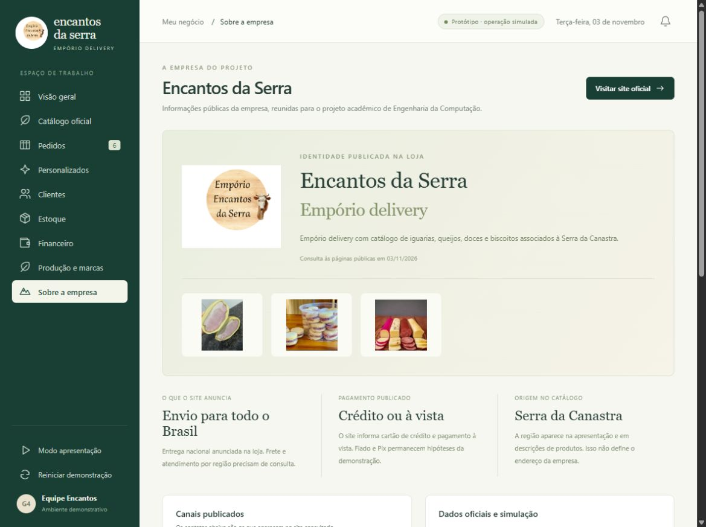

# Encantos da Serra · protótipo de ERP

Projeto acadêmico de Engenharia da Computação para demonstrar a organização do atendimento e dos pedidos da Encantos da Serra, com controle de estoque e contas a receber.

**[Acessar a demonstração pública](https://encantos-da-serra-erp-demo.sureporcupine.chatgpt.site)**

O link abre pelo navegador em outro computador, sem baixar o projeto e sem login. Os dados da operação são simulados e ficam somente no navegador de cada visitante. Não há sincronização entre computadores.



## Funcionalidades demonstradas

- Painel com pedidos em andamento, alertas e saldo a receber.
- Catálogo com 13 produtos, fotos e preços consultados no site oficial em 03/11/2026.
- Formulário que cria uma solicitação e preserva o canal de origem.
- Quadro de pedidos com cinco etapas de atendimento.
- Visão de personalizados com aprovação de orçamento.
- Cadastro e histórico de clientes B2C/B2B, incluindo recompra.
- Estoque por lote, entradas, perdas e sugestão por vencimento.
- Baixa de estoque na conclusão com proteção contra duplicação.
- Contas a receber, vendas a prazo e recebimentos parciais.
- Informações da empresa, fontes oficiais e modo de apresentação.

Leia o [texto das funcionalidades propostas](docs/FUNCIONALIDADES_PROPOSTAS.md) para a explicação completa e os limites de cada módulo.

## Interface e navegação

- O menu superior mostra os módulos disponíveis para o perfil ativo. Em telas menores, use o botão de menu no cabeçalho.
- **Mais opções** reúne Matriz de Permissões, Apresentação executiva e Reiniciar simulação. O Console da API aparece nesse submenu para os perfis que têm acesso.
- O cabeçalho do portal Cliente B2B e do formulário público de pedidos exibe links de telefone, WhatsApp, e-mail e Instagram. Os dados são compartilhados com a aba **Sobre a empresa**.
- A interface usa o logotipo do perfil da marca no Instagram, enquadrado proporcionalmente, e uma paleta de creme, marrom madeira e dourado. O verde identifica indicadores positivos.

[Prévia privada desta interface](https://encantos-da-serra-paleta.wisewasp22.chatgpt.site). O acesso requer a conta autorizada do ChatGPT. Para executar as rotas da API, use o servidor local.

## Executar localmente

É necessário Node.js 20 ou superior. O protótipo usa HTML, CSS e JavaScript, sem dependências npm.

```bash
npm start
```

Abra `http://127.0.0.1:4173`. Use `Ctrl+C` para encerrar o servidor.

## Verificações

```bash
npm run check
npm test
```

Os testes cobrem conclusão idempotente, seleção por validade, bloqueio no limite de sete dias, estoque insuficiente sem baixa parcial, aprovação de personalizado, vencimento, recebimentos parciais, atualização do catálogo e validade indeterminada.

Para validar a proposta de banco e gerar novamente seu dicionário, use Python 3:

```bash
python database/validar_e_documentar.py
```

## Estrutura

```text
prototipo/
  dist/                   Interface e imagens oficiais locais
  core.test.cjs           Testes das regras simuladas
  server.mjs              Servidor HTTP para revisão local
database/                 DDL SQLite e validador
docs/                     Escopo, funcionalidades, fontes e diagramas
apresentacao/             PowerPoint da entrega inicial
empacotar.py              Gerador de HTML único e ZIP offline
```

## Documentação

- [Funcionalidades propostas](docs/FUNCIONALIDADES_PROPOSTAS.md)
- [Escopo e pendências](docs/ESCOPO.md)
- [Fontes das informações oficiais](docs/FONTES_OFICIAIS.md)
- [Dicionário de dados](docs/DICIONARIO_DE_DADOS.md)
- [Diagrama de dados](docs/DIAGRAMA_DADOS.md)
- [Roteiro de apresentação](docs/ROTEIRO_APRESENTACAO.md)
- [Créditos](CREDITOS.md)

## Versão offline

Com Python 3, execute:

```bash
python empacotar.py
```

O comando gera `INICIAR.html`, com os scripts e imagens incorporados, e o pacote `Encantos_da_Serra_Kit_Apresentacao.zip`. Esses arquivos gerados não são versionados.

## Limites

Este repositório contém uma demonstração acadêmica. Clientes, pedidos, saldos, custos e recebimentos são fictícios. A data de negócio da demo permanece em 03/11/2026. Os preços do catálogo refletem a consulta naquela data e podem mudar na loja. Pedidos já existentes preservam os valores do cenário de simulação.

Não há integração real com WhatsApp, Instagram ou Nuvemshop, envio de pedidos à empresa, processamento de pagamentos, autenticação por perfil, backend transacional ou banco conectado. O SQL de 29 tabelas é uma proposta separada da interface. Fiado, personalizados e regras de validade precisam de validação com a empresa.

O PowerPoint corresponde à apresentação inicial. O modo de apresentação no próprio site inclui a atualização com as informações oficiais da empresa.
