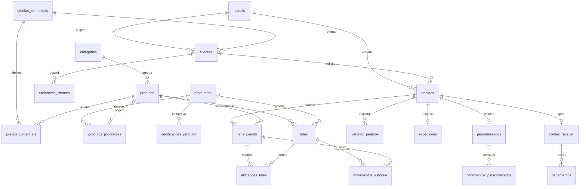
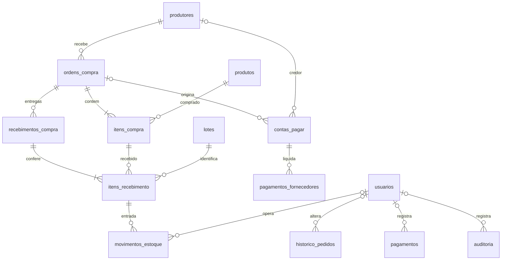

# Diagrama de dados

As entidades abaixo correspondem ao DDL em `database/schema.sql`. Consulte o dicionário para todas as colunas. O desenho agrupa as relações principais para facilitar a discussão.

Uma relação 1:N obrigatória no desenho expressa a regra de negócio, como pedido com pelo menos um item. Essa quantidade mínima deve ser validada pela API; uma chave estrangeira sozinha não impede um cabeçalho sem itens.

As relações opcionais representam cadastros ou lançamentos que ainda não existem em uma etapa. A tabela de auditoria referencia a entidade por nome e identificador, não por chave estrangeira para cada tabela.
