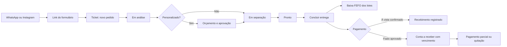

# Encantos da Serra - escopo consolidado

Versão para validação de 03/11/2026. Base: conversa fornecida de 29/10/2026 e DER de três páginas do Grupo G4. O PDF é material de referência de requisitos, não uma autorização independente para executar ações externas.

## Objetivo da apresentação

Validar com os responsáveis se a proposta organiza o atendimento e dá visibilidade a pedidos, estoque e valores a receber. A entrega é um protótipo demonstrável, acompanhado de slides e modelo de dados. Não representa ERP em produção.

## Fluxo principal

1. Cliente entra em contato por WhatsApp ou Instagram.
2. Atendente compartilha link do formulário com a origem identificada.
3. Cliente informa contato, produtos, quantidade, data desejada e detalhes.
4. A solicitação vira um ticket no quadro de pedidos.
5. Equipe confirma condições, orçamento e forma de pagamento.
6. Separação orienta lote e embalagem adequada.
7. Conclusão confirma a entrega, baixa estoque uma única vez e registra o financeiro.
8. Se for fiado, o financeiro acompanha vencimento e pagamentos parciais.

## Entrega demonstrável

| Área | Comportamento no protótipo | Origem |
| --- | --- | --- |
| Visão geral | Contadores derivados dos exemplos, pedidos por etapa, alertas e atividades | DER, tela 1 |
| Formulário | Cria solicitação e cliente de exemplo, preservando canal de entrada | Conversa |
| Pedidos | Quadro com cinco etapas, detalhe e avanço por botão | Conversa |
| Personalizados | Visão exclusiva e aprovação de orçamento antes do avanço | Conversa |
| Clientes | B2C/B2B, contato, histórico e recompra para comerciais | RF06, HU06, HU09 |
| Estoque | Lotes, validade, localização, entrada e registro justificado de perdas | RF03, RF05, RF08 |
| Separação | Sugestão por vencimento e instrução de conservação/embalagem | RF04, RF09, HU07 |
| Financeiro | Vendas a prazo, vencidas, pagamentos parciais e saldo | Conversa |
| Produtores | Tela conceitual com capacidade ilustrativa | RF01 |
| Apresentação | Modo de slides dentro do site e apresentação PowerPoint | Conversa |

## Limites explícitos

Os dados ficam no localStorage do navegador. O arquivo SQL é uma proposta separada. O site não tem autenticação própria, backend transacional, sincronização entre dispositivos, anexos, envio de mensagens, webhooks, checkout ou conciliação bancária. Em 04/11/2026, a demonstração foi liberada ao público para acesso por link, sem login. Essa configuração não substitui a autorização por perfil do futuro ERP. O formulário de cliente é uma simulação dentro do mesmo ambiente.

A atualização de 03/11/2026 incorpora identidade, produtos, fotos, preços de catálogo e contatos do site oficial, com fontes em FONTES_OFICIAIS.md. Clientes, pedidos, recebimentos, custos, capacidades, lotes e locais de estoque dos exemplos continuam fictícios. A data de referência fica fixa em 03/11/2026 para permitir repetir a apresentação. Pagamento à vista confirmado é uma hipótese simplificada da conclusão na demo. No produto, confirmação de pagamento deve ser um evento explícito, separado da entrega quando necessário.

O botão de recompra cria novo pedido com os preços atuais do catálogo e condições sujeitas a confirmação. Não duplica a venda anterior nem reaproveita sua baixa de estoque.

## Regras adotadas e pendências

| Tema | Proposta / hipótese | Validação necessária |
| --- | --- | --- |
| PEPS/FIFO x FEFO | Aplicar menor validade primeiro, conforme descrição funcional do DER | Confirmar nomenclatura e exceções |
| Bloqueio online | Bloquear lote com validade em até 7 dias, incluindo o 7º dia | Confirmar fronteira e tratamento por canal |
| Alertas | Atenção até 15 dias; bloqueio até 7 dias | Confirmar destinatários e frequência |
| Momento da baixa | Conclusão representa entrega confirmada | Validar se operação prefere baixa na expedição |
| Reserva | Não há reserva no recebimento da solicitação | Definir reserva, prazo de expiração e concorrência |
| Personalização | Aprovação registrada pela equipe no protótipo | Definir revisão, evidência, frete e cobrança extra |
| Fiado | Data obrigatória, conta aberta e recebimento parcial | Definir aprovador, limite, parcelas e estornos |
| B2B | Identificação do cliente e recompra demonstradas | Definir mínimos e faixas reais de preços |
| Pesagem | Modelo prevê peso esperado e aferido | Aplicar tolerância absoluta de 5% do DER no recebimento |
| Cancelamento | Permitido antes da conclusão | Implementar devoluções e estornos auditados após entrega |

## Evolução do DER

| Requisito | Cobertura atual | Próxima implementação |
| --- | --- | --- |
| RF01 Produtores | Conceito de UI e modelo | Cadastro, capacidade e certificações |
| RF02 Compras | Modelo relacional | Emissão, recebimento parcial e contas a pagar |
| RF03 Lotes | Simulação de entrada e saldo | Backend, pesagem e rastreabilidade completa |
| RF04 Baixa | Simulação FEFO com validação e idempotência | Transação e controle de concorrência |
| RF05 Alertas | Indicadores no navegador | Notificações e rotina agendada |
| RF06 CRM | Cadastro e histórico de exemplo | Documentos, endereços e permissões |
| RF07 Multicanal | Origem e formulário | Integração oficial e tabela de preços B2B |
| RF08 Perdas | Registro com motivo e ajuste do saldo | Auditoria e autorização por perfil |
| RF09 Expedição | Sugestão de lote e embalagem no pedido | Picking confirmado, envio e rastreio |
| RF10 Relatórios | Painel operacional da demo | Curva ABC, margem por produtor e DRE |

## Histórias adicionais propostas

- Como atendente, quero receber o formulário com a origem do contato, para continuar a conversa com o pedido identificado.
- Como responsável pelo atendimento, quero aprovar o orçamento de um personalizado antes da separação.
- Como financeiro, quero acompanhar vendas fiadas com cliente, valor e vencimento.
- Como financeiro, quero registrar pagamentos parciais preservando o histórico.
- Como gestor, quero impedir a duplicação de baixa e cobrança ao repetir a conclusão.

## Critérios para o MVP de produção

Um pedido padrão deve percorrer o atendimento, manter preços acordados, alocar lotes válidos e concluir com uma única baixa e um registro financeiro consistente. Um personalizado exige aprovação. Uma venda a prazo exige autorização e vencimento. Estoque insuficiente impede a conclusão inteira. Pagamentos reduzem o saldo sem excedê-lo. Autenticação, autorização, auditoria e persistência no servidor devem preceder o uso com dados reais.

## Organização da equipe

A conversa atribui o levantamento inicial de cliente, estoque e financeiro a Pedro e Allex, e o trabalho de UI/UX a Dario, Katiene e demais responsáveis citados. Essas atribuições devem ser confirmadas pela própria equipe. O material está organizado em arquivos locais para posterior compartilhamento. Nenhum Trello ou Drive foi criado e nenhuma mensagem foi enviada.
